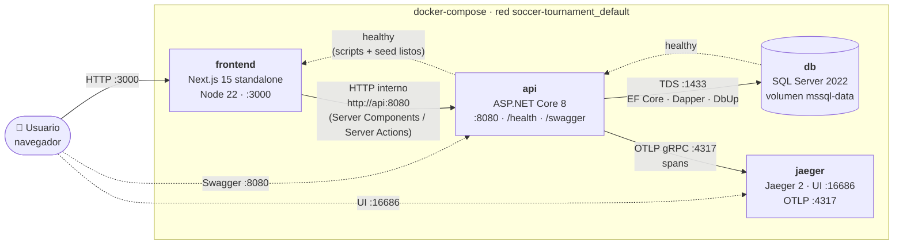
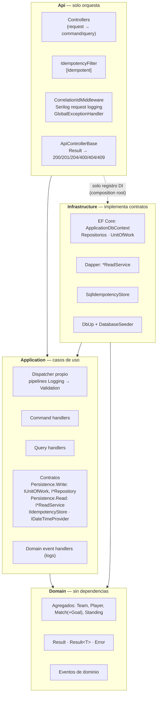
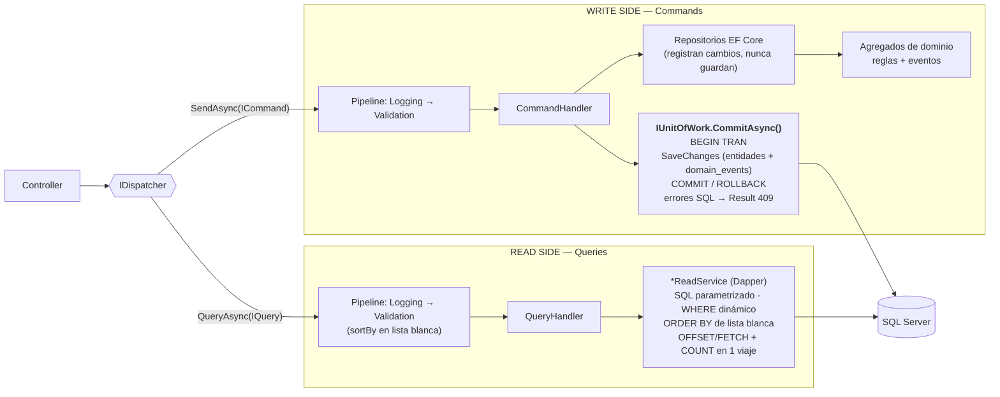
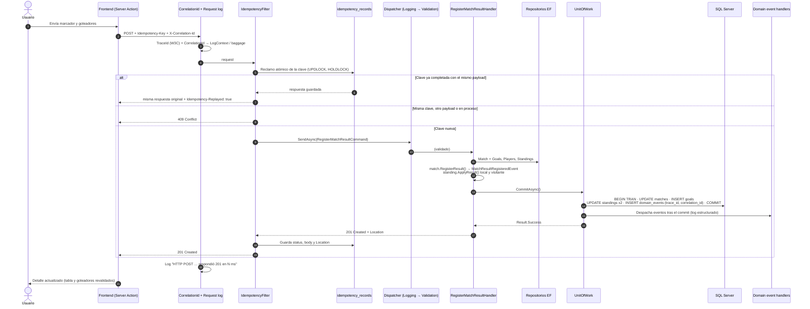
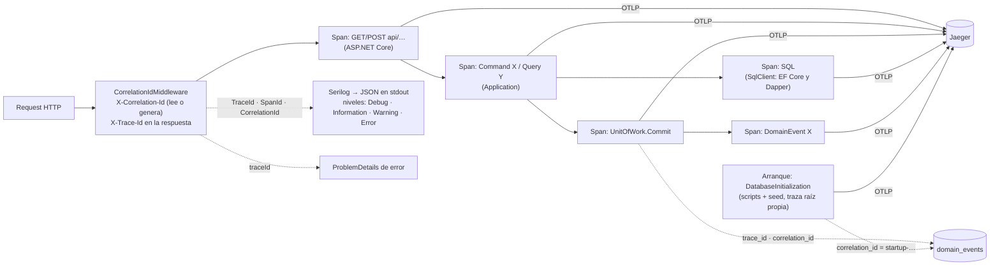

# Arquitectura — Soccer Tournament

Diagramas en [Mermaid](https://mermaid.js.org/) (GitHub los dibuja directamente).

1. [Despliegue con Docker](#1-despliegue-con-docker)
2. [Capas (Clean Architecture)](#2-capas-clean-architecture)
3. [CQRS: escritura y lectura](#3-cqrs-escritura-con-ef-core-lectura-con-dapper)
4. [Flujo de un command: idempotencia, Unit of Work, eventos y trazas](#4-flujo-completo-de-un-command)
5. [Observabilidad: logs y trace flow](#5-observabilidad-logs-y-trace-flow)

---

## 1. Despliegue con Docker

Orden de arranque garantizado por healthchecks: **db → api → frontend**.
La API ejecuta los scripts versionados (DbUp) y el **seed** antes de escuchar; cuando queda *healthy*, la tabla de posiciones ya se puede consultar.
Todos los servicios usan `restart: unless-stopped`.

---

## 2. Capas (Clean Architecture)

| Regla | Cómo se garantiza |
|---|---|
| Domain no depende de ninguna capa | Sin referencias de proyecto + `LayerDependencyTests` |
| Application depende solo de Domain | Referencia única + prueba de ensamblados |
| Infrastructure implementa contratos | Interfaces en `Application.Abstractions` |
| Api solo orquesta | Controllers solo usan `IDispatcher` (`ApiControllers_ShouldOnlyOrchestrateThroughApplication`) |

---

## 3. CQRS: escritura con EF Core, lectura con Dapper

- **Commands** solo conocen `Persistence.Write`; **queries** solo `Persistence.Read`. `CqrsTests` lo verifica, junto con que **todo** command handler usa `IUnitOfWork`.
- `SaveChanges` solo existe dentro de `UnitOfWork`; `UnitOfWorkTests` inspecciona el IL compilado de toda la solución.
- La tabla de posiciones es una proyección materializada (`standings`) que el command `RegisterMatchResult` actualiza **en la misma transacción** que el partido y sus goles. La query la ordena con `ROW_NUMBER()` por puntos → diferencia de gol → goles a favor.

---

## 4. Flujo completo de un command

Registrar un resultado: `POST /api/matches/{id}/result`

---

## 5. Observabilidad: logs y trace flow

Un mismo **TraceId** enlaza: header `X-Trace-Id` ↔ `traceId` del ProblemDetails ↔ logs JSON ↔ `domain_events.trace_id` ↔ traza en Jaeger.
Los logs no incluyen cuerpos, query strings, IPs ni cadenas de conexión.
